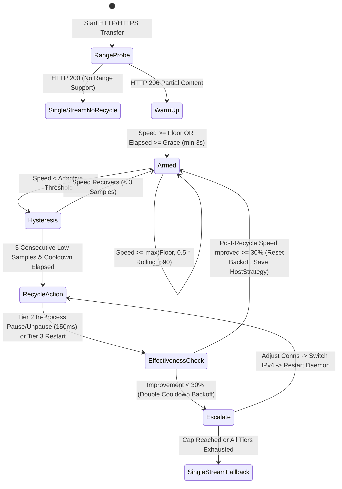

# `parallel-dl` (`pdl`) v4.0.0 — Developer Context & Architecture Reference

> **Purpose of this Document**: Comprehensive technical context, architecture reference, Watchdog v2 state machine specification, CLI contract, and operational guide for the modernized `parallel-dl` (`pdl`) v4.0.0 download accelerator on macOS (Apple Silicon ARM64).

---

## 1. Executive Summary

`parallel-dl` (invoked as `pdl` or `parallel-dl`) is a modular, type-checked Python 3.11+ (3.12 targeted) multi-engine download accelerator for macOS (Apple Silicon ARM64). It unifies:
1. **Aria2 JSON-RPC 2.0 Segmented HTTP/HTTPS & BitTorrent Transport** (`127.0.0.1` loopback daemon, `0600` config file secret isolation, `--stop-with-process` lifecycle safety, `64M` disk cache, APFS `file-allocation=none`, adaptive mirror selection, and automatic final size + server digest verification).
2. **Anti-Throttle Watchdog v2 (`--watchdog v2`, with legacy `--watchdog v1` and `--watchdog off`)**: Up-front `Range: bytes=0-0` 206 detection, adaptive rolling `p90` threshold (`max(user_floor, 0.5 * rolling_p90)`), 3-sample hysteresis, tiered mitigation (Tier 1 native `lowest-speed-limit`, Tier 2 in-process `aria2.forcePause`/`unpause` socket cycling, Tier 3 process restart), 30% effectiveness verification, exponential backoff escalation ladder (connection tuning -> IPv4 fallback -> single stream), and SQLite per-host strategy persistence.
3. **Media Stream Engine (`yt_dlp` Python API + Progressive Watchdog Handoff + CoreAudio/FFmpeg + Mutagen)**: Single-pass in-process `yt_dlp` resolution, pinned `yt-dlp-ejs` challenge solver (`deno` -> `node >= 22` -> `quickjs` -> `bun [deprecated]`), automatic handoff of progressive HTTPS media streams to `Aria2Engine` for Watchdog v2 supervision, honest audio format reporting (`passthrough AAC`, `ALAC-wrapped lossy`, `true lossless`, or `native`), and automatic cover art (`MP4 covr` / `ID3 APIC` / `FLAC Picture`) + metadata (`title`, `artist`, `album`, `year`) embedding with sidecar thumbnail cleanup.
4. **GitHub PowerSuite (`gh:`) & Verified Binary Installer (`pdl install`)**: Release asset scoring for macOS ARM64, ETag-cached API queries, rate-limit diagnostics, multi-file Aria2 RPC batch downloads with global connection budget (`<= 16`), and mandatory SHA-256 verification (release asset `digest` or companion checksum file; requires `--yes` if unsigned) before extracting or running any binary.
5. **Hugging Face Hub Engine (`hf:`)**: Sends `Authorization: Bearer <token>` (`HF_TOKEN` / `HUGGING_FACE_HUB_TOKEN`) on **all** single-file and batch paths, automatically verifies `X-Linked-ETag` / LFS `oid` SHA-256 digests, and uses optional `huggingface_hub[hf_xet]` when installed with seamless fallback to the Aria2 JSON-RPC engine.
6. **Apple IPSW Firmware Engine (`ipsw:`)**: Resolves device aliases (`ipsw:iPhone 16 Pro` -> `iPhone17,1`) and direct Apple CDN URLs against the `ipsw.me` v4 API and automatically verifies the downloaded firmware against Apple's signed TSS SHA-256 catalog.
7. **Resilience Core (`events.py`, `platform/macos.py`, Learned Profiles)**:
   - **Unified Event Source (`events.py`)**: Detects `WAKE` (wall-clock jump vs. `time.monotonic()`), `NET_CHANGE` (interactive `scutil` watcher on `State:/Network/Global/IPv4`, `State:/Network/Global/IPv6`, and Wi-Fi `AirPort` keys, falling back to `route -n monitor` and then `scutil --nwi` polling, debounced over ~2 s), and `STALL` (no byte progress for `--stall-timeout` seconds, default `30`). Every event triggers the same recovery action: recycle all connections, re-resolve DNS, reset the speed baseline, and log the reason.
   - **Idle-Sleep Assertion**: Holds `caffeinate -i -w <pdl pid>` while any download runs (default ON; disable with `--no-caffeinate`).
   - **Start-Up Guards**: Fails early with a clear error message if free disk space is less than `expected_bytes + safety_margin`, or if power policy (`--require-ac`, `--pause-on-low-power` via `pmset -g batt` and Low Power Mode) is violated.
   - **Learned Profiles (`learned_profiles` in `history.db`)**: Keyed by `(host, hour_bucket, network_id)` storing `best_connections`, `ip_family`, `recovery_action`, `speed_before_bps`, and `speed_after_bps`. Automatically applied at transfer start; profiles older than 30 days undergo a short ramp-up re-validation first. Managed via `pdl profiles` and `pdl profiles reset <host>`.
8. **Mirrors, Metalink, Persistent Queue & Scheduling (Part B)**:
   - **Mirrors & Metalink (`mirrors.py`)**: Resolves alternate URLs from `$PDL_HOME/mirrors.json` (exact, prefix, glob, or regex rules) and repeatable `--mirror <url>` flags. Probes all mirrors before transfer to reject size mismatches (`mirror_rejected`), drops mirrors after repeated failures (`mirror_dropped`), and hands all valid URIs to `aria2c` with `--uri-selector=adaptive`. Automatically discovers `.meta4` / `.metalink` companions and hands them to `aria2.addMetalink` with `--check-integrity=true` so `aria2c` repairs bad chunks natively without custom repair code. Verifies final file cryptographic hash when known.
   - **Persistent SQLite Queue (`queue.py`, `queue_jobs` in `history.db`)**: Supports `pdl queue add/list/remove/pause/resume/run` and `pdl resume --all`. `pdl queue run` executes in the foreground with a global connection budget (`<= 16`) ordered by `priority DESC, id ASC`, automatically recovers unfinished jobs left in `status = 'running'` after a crash or reboot, and reuses Part A guards (queued jobs default to `--require-ac` ON, overridable via `--no-require-ac`).
   - **Scheduling (`--when-fast`, `--at HH:MM`, `pdl queue launchd-plist`)**: `--when-fast [RATE]` gates start and periodically re-tests throughput during active downloads against a short range speed probe, deferring/pausing jobs when throughput is below threshold. `--at HH:MM` defers execution until the specified 24-hour clock time. `pdl queue launchd-plist` generates a `plutil -lint`-validated macOS LaunchAgent plist in the workspace (`RunAtLoad`, `StartCalendarInterval` or `StartInterval`, logs under `$PDL_HOME/logs/`) and prints manual load instructions without ever running `launchctl` or installing a background daemon.
   - **Experimental `--interface` Verification (Omitted)**: Empirically verified on macOS that `aria2c --interface=<name>` only binds the adapter's source IP (`getifaddrs` + `bind`) without setting Darwin's `IP_BOUND_IF` socket option (`_if_nametoindex` is absent from `aria2c`), so packets still follow the kernel default route. Per specification, `--interface` is omitted.
9. **Post-Processing & Diagnostics**: Streaming multi-algorithm hashing (`MD5`, `SHA1`, `SHA256`, `SHA512`, `BLAKE2b`), traversal-hardened archive extraction (`tarfile` `filter="data"`, member path & symlink escape validation for tar and zip), Android ADB push (`--push` / `--adb`), `pdl netprobe <url>`, and `pdl bench <url>`.
10. **macOS Integration & Security Hardening (Part C)**:
    - **Keychain-Backed Token Storage (`auth.py`, `pdl auth`)**: Prompts via `getpass` and stores tokens in the macOS Login Keychain under service `"pdl"` using `security -i` over stdin. Guarantees secrets are never exposed in process argv, command logs, or JSON events. Strict lookup order: Explicit Environment Variable (`HF_TOKEN` / `GITHUB_TOKEN`) -> macOS Login Keychain -> Cache/None. `pdl auth status` reports configured state without printing secrets; `pdl auth remove` purges credentials.
    - **Finder & Gatekeeper Integration (`platform/macos.py`, `--no-xattr`, `--sign`)**:
      * Automatically writes download source URLs into the `com.apple.metadata:kMDItemWhereFroms` extended attribute as a binary plist (`plistlib.dumps(..., fmt=plistlib.FMT_BINARY)`) via `xattr -w -x` after successful transfers. Enabled by default; disabled with `--no-xattr`.
      * `pdl install`: After cryptographic checksum verification (asset digest or companion checksum), runs `codesign --verify` and `spctl --assess` and reports Gatekeeper status. Ad-hoc signing (`codesign --force --sign -`) is offered and applied only when `--sign` is explicitly passed.
      * Quarantine removal (`xattr -d com.apple.quarantine`): Removed **only** for binaries that `pdl` itself verified against an authoritative SHA-256 digest; preserved if bypassed with `--yes`.
    - **Isolated Hook Runner & Native Notifications (`hooks.py`, `--notify`)**:
      * Discovers executables in `$PDL_HOME/hooks/on_complete` (on success) and `$PDL_HOME/hooks/on_fail` (on failure), feeding the result JSON on stdin with a strict 30 s timeout (`DEFAULT_HOOK_TIMEOUT_SEC = 30.0`). Hooks run in process isolation and never block or crash pdl.
      * Built-in `--notify` action: Uses `osascript` `"display notification"` with AppleScript string escaping for completion, transfer failure, watchdog give-up, and queue run summaries.
    - **Comprehensive Environment Doctor (`doctor.py`, `pdl doctor`)**: Audits `yt-dlp` and `yt-dlp-ejs` versions, flags a warning when `yt-dlp` release is older than 30 days, reports authentication status, verifies availability of macOS built-in utilities (`caffeinate`, `scutil`, `pmset`, `security`, `codesign`, `spctl`, `xattr`), and displays exact remediation commands for any missing or outdated components.
11. **Homebrew Package & Bottle Engine (`pdl brew`, `engines/brew.py`)**:
    - Resolves formula metadata, direct GitHub Packages (GHCR) CDN bottle URLs, and authoritative SHA-256 digests via `formulae.brew.sh`.
    - Downloads the verified bottle archive with 16 parallel channels directly into Homebrew's local download cache (`~/Library/Caches/Homebrew/downloads/`).
    - **Transitive Dependency Pre-Flight**: Inspects formula dependency trees, queries `brew list --formula` for uninstalled dependencies, and pre-downloads all missing dependency bottles in parallel with 16 channels into Homebrew's cache before pouring.
    - Automates non-interactive pouring via Homebrew (`NONINTERACTIVE=1 HOMEBREW_NO_AUTO_UPDATE=1 brew install`), pouring completely offline from pre-downloaded cache in seconds.
    - Native support for `pdl brew update` and `pdl brew upgrade <formula>`.
12. **Python / PyPI Wheelhouse Engine (`pdl pip`, `engines/pypi.py`)**:
    - Resolves packages from PyPI JSON API, scoring binary wheels for macOS Apple Silicon (`cp312-macosx_...` / universal2) with fallback to source distributions.
    - Downloads wheels across 16 parallel channels with Watchdog v2 supervision and cryptographic SHA-256 pre-verification.
    - **Transitive Wheelhouse Pre-Flight**: Compiles the complete dependency tree (`uv pip compile -` in ~15ms, with PyPI `requires_dist` fallback) and pre-fetches all missing dependency wheels with 16 parallel channels into a temporary wheelhouse.
    - Installs offline via `uv pip install --find-links <wheelhouse>` (or `pip install --find-links`). Automatically detects and honors active `VIRTUAL_ENV` or custom `--python` environments.
13. **"Copy as cURL" Input Engine (`--from-curl`, `--clipboard`, `curl_parser.py`)**:
    - Safely parses pasted cURL commands from browser DevTools (Chrome, Firefox, Safari) using `shlex` (never shells or eval).
    - Accepts standard flags (`-H`, `--header`, `-b`, `--cookie`, `--compressed`, `-X GET`, `--user-agent`, `-e`/`--referer`). Enforces `http`/`https` protocols and rejects payload modifications (`--data*`, `-d`, `-F`).
    - Synthesizes a temporary Netscape-format cookie jar with strict `0600` permissions scoped strictly to the request host and hands it to `aria2c` (`--load-cookies`), ensuring cookies are never sent across domains on redirect. Guarantees file deletion on success or error.
    - Strictly redacts all cookie and header secrets from logs, CLI argv, and JSON events.
14. **Consolidated High-Performance Test Architecture**:
    - Multi-tiered structure: `tests/unit/` (<0.5s), `tests/integration/` (~5s), `tests/e2e/` (marked `@pytest.mark.slow`).
    - ONE unified throttling simulator (`tests/support/server.py`) implementing 11 named parametrizable network profiles.
    - ONE deterministic fake macOS subprocess runner (`tests/support/macos_fake.py`) with golden command outputs.
    - Protocol-based `Clock` abstraction eliminating real sleeps in watchdog and scheduler logic.
    - Autouse loopback-only socket guards and subprocess guards preventing WAN leaks or untracked tool execution.

---

## 2. Package Layout & State Paths

```text
pdl/
├── pyproject.toml                  # Hatchling build, console scripts: pdl & parallel-dl
├── parallel-dl.py                  # Backwards-compatible CLI entrypoint shim
├── _original/                      # Read-only (0444) rollback copies of v3.1.0-pro originals
│   ├── parallel-dl.py
│   └── PARALLEL_DL_DEV_CONTEXT.md
├── .agents/rules/pdl.md            # Non-negotiable engineering rules for AI agents
├── scripts/
│   └── install-local.sh            # Local uv tool installer & symlink updater
├── src/pdl/
│   ├── __init__.py                 # Single source of truth: VERSION = "4.0.0"
│   ├── paths.py                    # Centralized PDL_HOME path resolver (default ~/.config/pdl)
│   ├── models.py                   # TargetType, WatchdogMode, ExitCode, parse_rate, dataclasses
│   ├── config.py                   # PDLConfig (schema_version=2, validation, atomic writes, .bad backup)
│   ├── history.py                  # SQLite WAL store (downloads, host_strategies, learned_profiles, queue_jobs, http_cache)
│   ├── events.py                   # ResilienceEventSource (WAKE, NET_CHANGE, STALL) & start-up guards
│   ├── mirrors.py                  # MirrorManager ($PDL_HOME/mirrors.json, size validation, failure drop, Metalink)
│   ├── queue.py                    # QueueManager (SQLite persistent queue, --when-fast, --at, launchd-plist)
│   ├── toolchain.py                # Lazy cached binary discovery, NVM numeric sort, EJS config
│   ├── ui.py                       # Lazy Rich console, secret redactor, JSONL emitter, Live display
│   ├── net.py                      # Pooled httpx client, retry/backoff, RFC 6266, Range/HEAD prober, DNS refresh
│   ├── netprobe.py                 # `pdl netprobe <url>` 1/4/16 stream & IPv4/IPv6 throttle classifier
│   ├── bench.py                    # `pdl bench <url>` Watchdog v1 vs v2 vs off benchmark runner
│   ├── app.py                      # PDLApp orchestrator & TargetInspector
│   ├── auth.py                     # Keychain-backed token manager (pdl auth set/status/remove via security -i)
│   ├── doctor.py                   # System doctor (yt-dlp version/age, macOS utilities, auth, remediation)
│   ├── hooks.py                    # HookRunner ($PDL_HOME/hooks 30s timeout isolation, --notify osascript action)
│   ├── cli.py                      # Fast argparse CLI (<150ms startup), signal handlers in main()
│   ├── platform/
│   │   ├── __init__.py             # Platform package exports
│   │   └── macos.py                # Centralized macOS boundary (caffeinate, scutil, route, pmset, statvfs, plutil)
│   ├── engines/
│   │   ├── base.py                 # Swappable Engine Protocol
│   │   ├── aria2.py                # Aria2RpcDaemon & Aria2Engine (single + batch + mirrors/metalink + resilience)
│   │   ├── watchdog.py             # WatchdogController (v1, v2 adaptive p90, escalation ladder, learned profiles)
│   │   ├── hf.py                   # HuggingFaceEngine (Bearer auth, ETag SHA-256, hf_xet/Aria2)
│   │   ├── github.py               # GitHubEngine & BinaryInstaller (digest/companion verification)
│   │   ├── ipsw.py                 # IpswEngine (device aliases + signed TSS SHA-256 verification)
│   │   ├── cloud.py                # CloudResolver (Google Drive, Dropbox, Pastebin)
│   │   ├── media.py                # MediaEngine (single-pass yt_dlp, Aria2 handoff, CoreAudio, Mutagen)
│   │   ├── brew.py                 # BrewEngine (Homebrew bottle resolution, 16-stream cache pre-fill, dependency pre-flight)
│   │   └── pypi.py                 # PyPIEngine (PyPI JSON resolution, 16-stream wheelhouse pre-flight, uv/pip install)
│   └── postproc/
│       ├── checksum.py             # ChecksumEngine (streaming hashes + GNU/BSD companion parser)
│       ├── archive.py              # ArchiveExtractor (filter="data", path/symlink traversal guard)
│       └── adb.py                  # ADBDeviceSync
└── tests/
    ├── README.md                   # Test suite guide, conventions, and adding new fakes/scenarios
    ├── conftest.py                 # Worker-scoped throttle server, loopback socket guard, subprocess guard
    ├── unit/                       # Pure logic, isolated, zero network, fast (<0.5s total)
    ├── integration/                # Local loopback sockets, in-memory SQLite, fake macOS CLI runners (~5s)
    ├── e2e/                        # End-to-end full transfers, multi-second watchdog recycling, benchmarks (@pytest.mark.slow)
    └── support/                    # THE ONLY place for shared test code
        ├── fakes.py                # FakeKeychain, FakeAria2Server, FakeClock, and factories
        ├── golden/                 # Recorded macOS CLI outputs (scutil, pmset, networksetup, etc.)
        ├── guards.py               # Loopback-only socket guard and subprocess guard
        ├── macos_fake.py           # Deterministic macOS CLI subprocess runner
        └── server.py               # ONE local HTTP throttling simulator with 11 named profiles
```

### State Files (`PDL_HOME`, default `~/.config/pdl`)
All state paths are resolved via `src/pdl/paths.py` honoring `PDL_HOME`:
- `$PDL_HOME/config.json`: Schema-versioned configuration (`schema_version: 2`), written atomically via `tempfile.mkstemp` + `os.fsync` + `os.replace`. Corrupt files are backed up to `config.json.bad`. Includes resilience settings (`caffeinate: true`, `net_watch: true`, `stall_timeout: 30.0`, `require_ac: false`, `pause_on_low_power: false`).
- `$PDL_HOME/mirrors.json`: Optional JSON mapping URL patterns (exact, prefix ending in `/`, glob `*`, or regex) to alternate mirror URLs or templates (`{filename}`, `{path}`, `{url}`). Loaded automatically by `MirrorManager` before transfers.
- `$PDL_HOME/history.db`: SQLite database in `WAL` mode (`HISTORY_SCHEMA_VERSION = 4`) containing:
  - `downloads`: Completed/failed transfer log.
  - `host_strategies`: Legacy per-host watchdog summary (`host`, `preferred_connections`, `ip_family`, `throttle_mode`, `last_good_bps`, `updated_at`).
  - `learned_profiles`: Context-aware learned profiles with primary key `(host, hour_bucket, network_id)` and columns `best_connections`, `ip_family`, `recovery_action`, `speed_before_bps`, `speed_after_bps`, `sample_count`, `updated_at`.
  - `queue_jobs`: Persistent download queue (`id`, `target`, `target_type`, `out_dir`, `filename`, `mirrors_json`, `priority`, `connections`, `status`, `require_ac`, `pause_on_low_power`, `when_fast_bps`, `start_at`, `expected_length`, `expected_digest`, `bytes_downloaded`, `error`, `options_json`, `created_at`, `updated_at`).
  - `http_cache`: ETag/body cache for GitHub, Hugging Face, and IPSW API calls.
  - `schema_meta`: Schema version metadata. Automatically migrates legacy `$PDL_HOME/history.json` (read-only; never deletes `history.json`). Corrupt DBs are rotated to `history.db.bad`.
- `$PDL_HOME/logs/`: Standard output (`queue.out.log`) and error (`queue.err.log`) log directory referenced by generated LaunchAgent plists (`pdl queue launchd-plist`).
- `$PDL_HOME/hooks/`: User lifecycle action hooks. Executables in `$PDL_HOME/hooks/on_complete` and `$PDL_HOME/hooks/on_fail` receive the result JSON on stdin with a strict 30 s timeout. Never blocks or crashes pdl transfers.

---

## 3. Anti-Throttle Watchdog v2 State Machine



### Key Watchdog v2 Properties
- **Up-Front Range Probe**: Sends `Range: bytes=0-0` streaming `GET` before launching `aria2c`. If the server returns `200 OK` instead of `206 Partial Content`, connection recycling is disabled automatically (`connections=1`).
- **Adaptive Trigger**: `threshold = max(user_floor_bps, 0.5 * rolling_p90_bps)` once `>= 4` speed samples are collected, catching relative 50%+ collapses from high-speed bursts even when throughput remains above a static floor.
- **Hysteresis & Cooldown**: Requires 3 consecutive low samples and enforces a minimum cooldown (`15s` default in production) with exponential backoff when a recycle fails to improve throughput by `>= 30%`.
- **Empirical In-Process Socket Cycling**: `aria2.forcePause(gid)` + `aria2.unpause(gid)` closes all active HTTP/1.1 TCP sockets and opens fresh ephemeral TCP ports in `~150 ms` without restarting the `aria2c` process.
- **Per-Host Strategy & Learned Profile Store**: Successful mitigations and `pdl netprobe` classifications are persisted in SQLite (`host_strategies` and `learned_profiles`).
  - `learned_profiles` keys on `(host, hour_bucket, network_id)` (4-hour bucket `00-03` .. `20-23`, and active macOS SSID or primary interface).
  - Stores `best_connections`, `ip_family` (`auto`/`ipv4`/`ipv6`), `recovery_action`, `speed_before_bps`, `speed_after_bps`, `sample_count`, and `updated_at`.
  - At transfer start, `WatchdogController` applies the best matching profile (preferring exact hour bucket + network id, then matching network id, then most recent for host).
  - **30-Day Staleness Re-Validation**: Profiles older than 30 days (`2,592,000 s`) enter a short ramp-up re-validation window (`revalidating_profile` state). If observed speed reaches `>= 50%` of the recorded `speed_after_bps` (or user floor), the profile's `updated_at` timestamp is refreshed; otherwise the controller reverts to the requested connection budget (`revalidated_fallback`).
- **Resilience Event Core (`src/pdl/events.py`)**:
  - `WAKE`: Compares `time.time()` delta against `time.monotonic()` delta on every tick (`> 3.0s` jump indicates macOS sleep/wake).
  - `NET_CHANGE`: Spawns an interactive `scutil` watcher (`n.add` on `State:/Network/Global/IPv4`, `State:/Network/Global/IPv6`, and `State:/Network/Interface/.*/AirPort pattern`, followed by `n.watch`), falling back to `route -n monitor` and then a slow poll of `scutil --nwi`. Debounces notification bursts over `2.0 s`.
  - `STALL`: Triggers when downloaded byte progress does not advance for `--stall-timeout` seconds (default `30s`, `0` disables).
  - **Unified Recovery Action (`resilience_recycle`)**: Every `WAKE`, `NET_CHANGE`, or `STALL` event recycles all active connections (`forcePause`/`unpause`), re-resolves DNS (`re_resolve_dns`), resets the rolling speed baseline (`reset_speed_baseline`), and logs the event reason.
- **Start-Up Guards & Failure Behavior**:
  - **Idle-Sleep Assertion**: Holds `caffeinate -i -w <pdl pid>` while any download runs (`--no-caffeinate` disables).
  - **Free-Disk Check**: Before starting a transfer with known size, verifies `free_disk_bytes >= remaining_bytes + margin` (`margin = max(5% of remaining, min(10% of remaining, 64 MiB), 1 KiB)`). Fails early with `ExitCode.FAILURE` (`1`) and a clear error message showing required, expected, margin, and available space.
  - **Power Policy (`pmset -g batt` & `pmset -g`)**: Off by default for interactive runs. When `--require-ac` is passed on Battery Power, fails early with `ExitCode.FAILURE` (`1`). When `--pause-on-low-power` is passed and macOS Low Power Mode (`lowpowermode 1`) is active, pauses/defers and fails clearly with `ExitCode.FAILURE` (`1`) if Low Power Mode remains active.

---

## 4. CLI Reference, Exit Codes & JSONL Event Schema

### Stable Exit Codes (`ExitCode`)
| Code | Name | Meaning |
| :--- | :--- | :--- |
| `0` | `OK` | Transfer or subcommand succeeded |
| `1` | `FAILURE` | Transfer, start-up guard (insufficient disk / power policy), or runtime failure |
| `2` | `USAGE` | Invalid CLI arguments, unknown config key, or unparseable rate |
| `3` | `VERIFICATION_FAILED` | Checksum mismatch, size mismatch, unverified `pdl install` without `--yes`, or archive security violation |
| `4` | `MISSING_DEPENDENCY` | Required external binary (`aria2c`, `yt-dlp`) missing |
| `130` | `INTERRUPTED` | Interrupted by `SIGINT` / `SIGTERM` (partial `.aria2` state preserved) |

### Subcommands & Resilience Flags
```bash
pdl <target>...                        # Download any URL, shortcut (gh:/hf:/ipsw:), magnet, or search query
pdl auth set <hf|github>               # Prompt via getpass & store token in macOS Login Keychain via 'security -i' (zero argv leak)
pdl auth status [--json]               # Report authentication source (env/keychain/none) without printing secrets
pdl auth remove <hf|github>            # Delete token from macOS Login Keychain
pdl doctor [--json]                    # Comprehensive system toolchain, yt-dlp age, macOS utilities, & fix commands (alias: diagnose)
pdl install <owner/repo> [--yes] [--sign] [--no-xattr] # Download, verify SHA-256, Gatekeeper check, ad-hoc sign & install
pdl info <target> [--json]             # Inspect target classification and remote metadata
pdl hash <file> [--json]               # Compute MD5, SHA1, SHA256, SHA512, BLAKE2b (<60ms startup)
pdl --from-curl [cmd|file|-]           # Parse pasted cURL, extract host-scoped cookie jar (0600) & download
pdl --from-curl --clipboard            # Read pasted cURL directly from macOS clipboard via pbpaste
pdl extract <archive> [dest_dir]       # Safely extract archive with traversal & symlink validation
pdl history [limit] [--json]           # Display recent SQLite download history
pdl profiles                           # List learned per-host/hour/network profiles
pdl profiles reset <host>              # Reset learned profiles for <host> (or 'all')
pdl queue add <target> [-o <dir>] [--priority N] [--mirror <url>] [--when-fast [RATE]] [--at HH:MM] [--no-require-ac]
pdl queue list [--json]                # List persistent SQLite queue jobs (priority DESC, id ASC)
pdl queue pause <id>... | --all        # Pause queued or running jobs
pdl queue resume <id>... | --all       # Mark paused, failed, or crashed jobs back to 'queued'
pdl queue remove <id>... | --all       # Remove jobs from the persistent queue
pdl queue run [-c N] [--when-fast [RATE]] [--at HH:MM] # Foreground runner with global connection budget & crash-resume
pdl queue launchd-plist [-o <path>] [--at HH:MM | --interval SEC] # Generate LaunchAgent plist in workspace (never runs launchctl)
pdl resume --all                       # Resume all unfinished/paused/crashed queue jobs and run in foreground
pdl clean [dir]                        # Remove orphaned .aria2, .part, .ytdl, .pdl_raw_* files
pdl config [show|set|reset|reset-hosts]# View/update config.json or clear saved host strategies
pdl diagnose [--json]                  # Inspect system toolchain, yt-dlp-ejs version, & JS runtime (alias for pdl doctor)
pdl netprobe <url> [--duration 60] [--http3] # Diagnose ISP throttling & save host profile to SQLite
pdl bench <url> [--watchdog v1,v2,off] [--duration 60] # Benchmark watchdog modes back-to-back

# Resilience, Security, Finder, Queue & Scheduling Flags:
#   --sign                             Apply ad-hoc code signature ('codesign --force --sign -') to installed binary
#   --no-xattr                         Disable setting 'com.apple.metadata:kMDItemWhereFroms' extended attribute (default: enabled)
#   --notify                           Display native macOS notifications for completion, failure, give-up, and queue summary
#   --no-caffeinate                    Disable 'caffeinate -i -w <pid>' idle-sleep assertion (default: enabled)
#   --no-net-watch                     Disable scutil / route network-change watcher (default: enabled)
#   --stall-timeout <SEC>              No-progress stall timeout in seconds (default: 30; 0 disables)
#   --require-ac                       Require AC power via 'pmset -g batt' before starting (default: off interactive, ON queued)
#   --no-require-ac                    Disable AC power requirement (e.g. for queued jobs)
#   --pause-on-low-power               Pause/defer transfer when macOS Low Power Mode is active (default: off)
#   --mirror <URL>                     Repeatable alternate URL passed to aria2 with --uri-selector=adaptive
#   --when-fast [RATE]                 Start/continue only when short speed test exceeds RATE (e.g. 5MB/s), re-testing periodically
#   --at <HH:MM>                       Schedule fixed start time in 24-hour HH:MM format
#   --priority <INT>                   Queue job priority (higher integer runs first, default: 0)
#   --interval <SEC>                   StartInterval in seconds for 'pdl queue launchd-plist' (default: 900)
```

### macOS Integration, Security, Mirrors & Queue Failure Behavior
- **Keychain Token Security & Lookup Order**: Secret tokens are stored in macOS Login Keychain using interactive `security -i` over stdin (`add-generic-password -a <service> -s pdl -U -w <token>`), guaranteeing credentials never appear in process argv or process tables (`ps`). Lookup precedence: Explicit Environment Variable (`HF_TOKEN` / `GITHUB_TOKEN`) -> macOS Keychain (`service="pdl"`, `account="hf"|"github"`) -> None.
- **Finder Extended Attribute (`kMDItemWhereFroms`)**: Upon successful transfer completion, writes source URLs into `com.apple.metadata:kMDItemWhereFroms` as a binary plist (`xattr -w -x`). Enabled by default; `--no-xattr` disables.
- **Gatekeeper Verification & Quarantine Removal Policy**: During `pdl install`, after verifying SHA-256 against the release asset digest or companion checksum, pdl executes `codesign --verify` and `spctl --assess` and displays the security evaluation. Ad-hoc signing (`codesign --force --sign -`) is executed only with an explicit `--sign` flag. Quarantine attribute (`com.apple.quarantine`) is removed **only** for binaries that pdl itself cryptographically verified against an authoritative SHA-256 digest; if unverified and bypassed via `--yes`, the quarantine attribute is strictly preserved.
- **Hook Timeout & Process Isolation**: Executables placed in `$PDL_HOME/hooks/on_complete` (on success) or `$PDL_HOME/hooks/on_fail` (on failure) receive the result JSON on stdin with a strict 30 s timeout. If a hook hangs, it is terminated with `SIGKILL`. Hooks execute in isolated subprocesses and never block or crash pdl.
- **Native Notifications (`--notify`)**: Native macOS user notifications via `osascript` `"display notification"` with AppleScript character escaping for completion, transfer failure, Watchdog v2 tier give-up, and queue run summaries.
- **Mirror Size Mismatch**: Before transfer start, `MirrorManager.resolve_and_validate()` probes the primary URL and all candidate mirrors (`$PDL_HOME/mirrors.json` + `--mirror`). Any mirror reporting a `Content-Length` that differs from the primary/expected length is rejected (`mirror_rejected` event with `reason="size_mismatch"`) and excluded from `aria2c`.
- **Mirror Repeated Failures**: Any mirror that fails probing `>= 2` times or fails mid-transfer is dropped (`mirror_dropped` event with `reason="repeated_failures"`). If the primary server fails mid-transfer while healthy mirrors remain, `Aria2Engine` restarts the transfer with the remaining healthy mirrors.
- **Metalink Companion (`.meta4` / `.metalink`)**: Discovered automatically (`<url>.meta4`, `<filename>.meta4` in `out_dir`, or direct `.meta4`/`.metalink` target) and handed to `aria2.addMetalink` with `--check-integrity=true` so `aria2c` verifies piece hashes and repairs bad chunks natively without custom repair code.
- **Queue Crash-Resume & Guards**: On startup, `QueueManager.run_queue()` transitions any job left in `status = 'running'` back to `'queued'` (`queue_crash_recovered`) and resumes from existing partial files on disk. Queued jobs default to `--require-ac` ON; if on battery power, the start-up guard fails with `ExitCode.FAILURE` (`1`).
- **`--when-fast` & `--at HH:MM` Deferral**: If a job's `--at HH:MM` time has not arrived or its `--when-fast` short speed test is below threshold (either before start or on periodic mid-transfer re-test), `pdl queue run` emits `queue_job_deferred` and leaves the job in `status = 'queued'` so the next run resumes it cleanly.

### Structured JSONL Mode (`--json`)
Passing `--json` suppresses banners/Rich live progress and emits newline-delimited JSON objects to `stdout` with automatic secret redaction:
- `target_classified`: `{event, timestamp, target, target_type, clean_url, filename_hint, content_length, accept_ranges}`
- `progress`: `{event, timestamp, title, downloaded_bytes, total_bytes, percent, speed_bps, eta_seconds, connections, watchdog_state}`
- `watchdog_action`: `{event, timestamp, cycle, mode, action, resilience_event, reason, speed_bps, threshold_bps, rolling_p90_bps, connections}`
- `mirror_rejected`: `{event, timestamp, mirror_url, reason, expected_length, mirror_length}`
- `mirror_dropped`: `{event, timestamp, mirror_url, failures, reason}`
- `metalink_handoff`: `{event, timestamp, source, check_integrity, uris}`
- `when_fast_probe`: `{event, timestamp, url, attempt, measured_bps, threshold_bps, passed}`
- `queue_job_added` / `queue_list` / `queue_job_started` / `queue_job_deferred` / `queue_crash_recovered` / `launchd_plist_generated`
- `profiles`: `{event, timestamp, host, profiles}`
- `profiles_reset`: `{event, timestamp, host, cleared}`
- `auth_status`: `{event, timestamp, services}`
- `auth_set` / `auth_remove`: `{event, timestamp, service, success}`
- `install_security_check`: `{event, timestamp, file, codesign_valid, codesign_detail, gatekeeper_accepted, gatekeeper_detail, verified_by_pdl}`
- `doctor`: `{event, timestamp, version, ytdlp, ytdlp_ejs, auth, macos_utilities, core_tools, fixes}`
- `verification`: `{event, timestamp, file, algorithm, expected, computed, verified, source}`
- `result`: `{event, timestamp, target, target_type, success, file_path, bytes_downloaded, duration, avg_speed_bps, recycle_count, audio_format_produced, checksum_verified, checksum_algo, checksum_digest, exit_code}`

---

## 5. Rules for LLM & Script Callers

1. **Always pass `-o <destination_dir>`** to scope downloaded files to the target project directory.
2. **Use `--non-interactive` and/or `--json`** in automated pipelines to guarantee zero TTY prompts and structured event output.
3. **Never pass `-c` above 16** (values `> 16` are automatically clamped to `16`, the `aria2c` per-server hard limit).
4. **Never pass secrets on the command line**: Export `HF_TOKEN` or `GITHUB_TOKEN` in the environment; `pdl` passes them via `0600` RPC options and redacts them from all logs and JSON events.

---

## 6. ISP Throttling Diagnostic Suite (`pdl.throttle`)

Modernized network diagnostic subpackage (`src/pdl/throttle/`) providing empirical characterization of ISP throttling policies, path quality, and flow scaling behavior to tune download parameters.

### Commands
- `pdl throttle quick`: ~3-minute paired measurement run against public speed targets and domestic peering points. Default 300 MB hard budget cap.
- `pdl throttle full`: Comprehensive M0–M10 deep diagnostic run across all measurement modules with cumulative FUP analysis. Default 3 GB hard budget cap.
- `pdl throttle sample`: Lightweight 20-second background probe designed for sparse, irregular sampling. Idempotent within 45 minutes; skips on battery power unless `--yes`/`--force`.
- `pdl throttle coverage`: 24-hour hour-of-day × weekday/weekend coverage matrix showing measured cells and prioritizing next-best sampling hours.
- `pdl throttle launchd-plist`: Generates (never loads) a `LaunchAgent` plist for opportunistic hourly background sampling.
- `pdl throttle report [--html]`: Rebuilds terminal, Markdown (`report.md`), JSON (`report.json`), and self-contained HTML (`report.html`) reports from stored runs.
- `pdl throttle server`: Lightweight asyncio TCP & UDP VPS server (`pdl.throttle.server`) for ground-truth sweeps.
- `pdl throttle targets`: Lists and validates configured target candidates from `$PDL_HOME/targets.toml` or `--domestic`.

### ISP Configuration
Configured via `PDLConfig.isp` (default: `"Duronto Internet"`, Bangladesh) or CLI flag `--isp NAME`. Printed in every report header and in the neutral ISP evidence summary.

### Measurement Modules
- **M0 Sanity & Local Factors**: Loopback throughput self-test against local simulator/server, active interface detection (Wi-Fi vs Ethernet, link rate), VPN/tunnel leak warnings, CPU load, and `nettop` competing traffic checks.
- **M1 Baseline Path Quality**: Multi-resolver DNS resolution latency, TCP connect time, ping RTT/jitter, loss percentage, and path MTU probe via `ping -D` (DF bit).
- **M2 Single-Flow Time Series**: 250 ms throughput sampling to detect burst collapse and steady-state speeds.
- **M3 Flow Scaling**: Multi-stream scaling curve (1, 2, 4, 8, 16 connections) to detect per-connection caps vs shared line caps.
- **M4 Destination Independence**: Concurrent two-destination vs solo testing to separate per-destination host limits from upstream bandwidth limits.
- **M5 Burst & Token Bucket Analysis**: Quantitative estimation of initial burst speed, duration, token bucket byte capacity, drop shape (`step`, `decay`, `periodic`), and 30s/120s idle refill ratios.
- **M6 Policing vs Shaping**: Loaded RTT inflation under load vs idle RTT and `netstat -s -p tcp` retransmit rate deltas to distinguish loss-based policing from queue-based shaping.
- **M7 Protocol & Port Differentiation**: Comparison of HTTP/1.1 vs HTTP/2 vs HTTP/3, port 443 vs alternative ports, IPv4 vs IPv6, and SNI differentiation.
- **M8 Cumulative Volume & Upload**: Long-run transfer analysis to detect volume-based step-downs (Fair Usage Policy) and upload-to-download asymmetry.
- **M9 Ground-Truth Sweeps**: Paired comparison against a user-controlled VPS test server or proxy.
- **M10 Domestic vs International & Caching**: Paired same-moment comparisons between local peering (e.g. BDIX in Bangladesh), ISP cache nodes, and uncached international transit routes with Team Cymru ASN resolution.

### Classifier & Reporting
- Rule-based classifier mapping telemetry to 12+ canonical verdict classes.
- Mann-Whitney U rank-sum test ($p \le 0.05$) gating time-of-day congestion claims.
- Actionable download profiles saved directly into `HistoryManager` under `host="*"`, `source="throttle-probe"`.
- Self-contained HTML reports featuring dark-mode CSS and inline SVG charts with zero external network dependencies.

