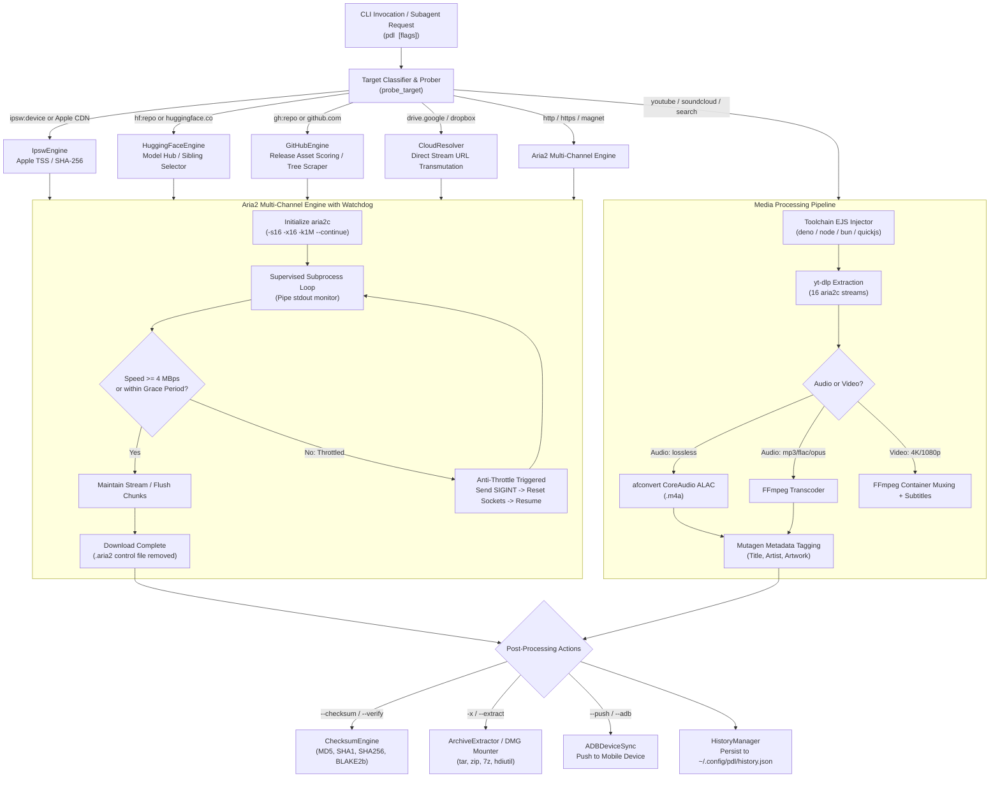

# PARALLEL-DL (`pdl`) Developer & LLM Context Specification

> **Target Audience**: AI Agents (LLMs), Systems Engineers, and Tool Integrators.  
> **Classification**: Core System Utility / Multi-Channel Download Accelerator.  
> **Source Repository / Path**: `/Users/tawsifx/.config/pdl/parallel-dl.py` (Script source) & `/opt/homebrew/bin/parallel-dl` (Production binary symlinked as `pdl`).  
> **Current Version**: `3.1.0-pro`  
> **Runtime Environment**: Python 3.10+ (macOS Apple Silicon / Darwin ARM64 optimized).

---

## 1. Executive Summary & Philosophy

`parallel-dl` (standard command-line invocation: `pdl` or `parallel-dl`) is a **production-grade multi-channel asset acceleration and ingestion suite**. It was created to eliminate the bandwidth degradation, single-stream rate-limiting, and protocol fragility inherent to default utilities such as `curl`, `wget`, `brew download`, or naive Python scrapers.

### Core Value Propositions
1. **Multi-Segment Saturation**: Splits downloads across up to 16 concurrent TCP connections via `aria2c`, utilizing chunked byte-range requests (`-s16 -x16 -k1M`).
2. **Anti-Throttle Watchdog**: A real-time supervised process monitor that continuously tracks aria2 transfer rates. When an ISP, CDN, or carrier throttles an active connection burst window below a configurable threshold (default **`4 MBps`**), the watchdog automatically sends `SIGINT`, recycles the socket pool, and resumes chunk transfer via `.aria2` control files.
3. **Automated EJS YouTube Pipeline**: Intercepts `yt-dlp` media extraction and automatically injects detected JavaScript runtimes (`deno`, `node` including NVM version trees, `bun`, or `quickjs`) along with `--remote-components ejs:github` to satisfy YouTube's modern JavaScript challenge solver specifications (`n`-sig and signature deciphering).
4. **Smart Target Probing**: Automatically categorizes raw inputs (URLs, queries, identifiers) into specialized download flows without requiring flags (e.g. `ipsw:iPhone14,5`, `hf:meta-llama/...`, `gh:owner/repo`, Google Drive links, YouTube links, raw torrents/magnets).
5. **Zero-Setup Binary Installer**: `pdl install <owner>/<repo>` queries GitHub releases, uses Darwin ARM64 architecture scoring to select the correct release asset, multi-streams the download, unpacks archives/DMGs, and drops executable binaries directly into `~/.local/bin/`.
6. **Lossless CoreAudio Pipeline**: Audio queries default to Apple CoreAudio Lossless (`afconvert -f m4af -d alac`), writing clean ALAC `.m4a` files with full ID3/MP4 metadata tagging via `mutagen`.

> [!IMPORTANT]
> **Identity Disambiguation**: This tool is the **Parallel Downloader Suite** (`parallel-dl`), authored specifically for high-speed automated asset acquisition on macOS. It is **NOT** IBM's Prompt Declaration Language (`pdl` cask on Homebrew). Never run `brew install pdl`.

---

## 2. Architectural Blueprint



---

## 3. File System & File Locations

| Path | Ownership / Permissions | Purpose |
| :--- | :--- | :--- |
| `/opt/homebrew/bin/parallel-dl` | `tawsifx:admin` (`755`) | Primary production executable. Executed when calling `parallel-dl`. |
| `/opt/homebrew/bin/pdl` | `tawsifx:admin` (`777` symlink) | Global system symlink pointing directly to `/opt/homebrew/bin/parallel-dl`. |
| `~/.config/pdl/parallel-dl.py` | `tawsifx:staff` (`644` / `755`) | Standalone user copy of the script. Kept **strictly synchronized** with `/opt/homebrew/bin/parallel-dl`. |
| `~/.config/pdl/bin/pdl` | `tawsifx:staff` (`755`) | Wrapper bash script executing `parallel-dl.py` via Python 3. |
| `~/.config/pdl/config.json` | `tawsifx:staff` (`644`) | Persistent user configuration file (connections, audio codec, default thresholds). |
| `~/.config/pdl/history.json` | `tawsifx:staff` (`644`) | Circular JSON history ledger containing last 50 completed downloads with metadata and hashes. |
| `~/.config/yt-dlp/config` | `tawsifx:staff` (`644`) | System configuration for `yt-dlp` declaring `--js-runtimes node` and `--remote-components ejs:github`. |
| `~/.local/bin/` | `tawsifx:staff` (`755`) | Target installation directory for `pdl install <repo>`. Must be in user's `$PATH`. |

---

## 4. Class & Engine Reference Guide

### 4.1. `Toolchain` (Lines 168–260)
Encapsulates runtime discovery, system binary resolution, and fallback probing:
- **Discovered Binaries**: `aria2c`, `yt-dlp`, `afconvert`, `ffmpeg`, `adb`, `hdiutil`, `7z`/`7za`.
- **JavaScript Runtimes for EJS**:
  - `deno`: Checks `/opt/homebrew/bin/deno`, `/usr/local/bin/deno`, `~/.deno/bin/deno`.
  - `node`: Checks `/opt/homebrew/bin/node`, `/usr/local/bin/node`, and dynamically traverses `~/.nvm/versions/node/v*/bin/node` to locate the latest active Node version.
  - `bun`: Checks `/opt/homebrew/bin/bun`, `~/.bun/bin/bun`.
  - `quickjs`: Checks for `qjs`.
- **`get_ytdlp_js_args()` Method**:
  Returns a list of flags to inject into every `yt-dlp` invocation:
  ```python
  ['--js-runtimes', 'deno:/opt/homebrew/bin/deno', '--js-runtimes', 'node:/path/to/node', '--remote-components', 'ejs:github']
  ```
- **Diagnostics (`js_runtime` property)**: Surfaces active JS runtime and binary path for `pdl diagnose`.

### 4.2. `TargetType` & `TargetInfo` (Lines 1425–1550)
- **Target Types**: `TORRENT`, `DIRECT`, `STREAM`, `SEARCH`, `GITHUB`, `HF`, `IPSW`.
- **Classification Rules (`probe_target`)**:
  1. `IpswEngine.is_ipsw(target)`: Matches `ipsw:<device>` or `*.ipsw` Apple CDN URLs.
  2. Magnet / Torrent: Matches `magnet:?` or `.torrent` file extension.
  3. `CloudResolver`: Intercepts Google Drive share links (`/file/d/<id>`) and Dropbox URLs, transmuting them into direct stream endpoints.
  4. `HuggingFaceEngine.is_hf(target)`: Matches `hf:<repo_id>` or `huggingface.co/<repo>/resolve/...`.
  5. `GitHubEngine.is_github(target)`: Matches `gh:<repo>` or `github.com/.../(releases|tree|blob)`.
  6. Media Domain Matching: Matches domains in `MEDIA_DOMAINS` (YouTube, SoundCloud, Bandcamp, Vimeo, Twitch, etc.).
  7. HTTP HEAD Probe: If `requests` is available, sends a non-blocking `HEAD` request to inspect `Content-Type`, `Content-Disposition`, and `Accept-Ranges: bytes`. If binary payload is detected, resolves as `DIRECT`.
  8. Default Fallback: Any arbitrary non-URL text string defaults to `TargetType.SEARCH` mapped to `ytsearch1:<query>`.

### 4.3. `Aria2Engine` & The Anti-Throttle Watchdog (Lines 1630–1805)
This is the core transport engine for segmented downloads.

#### Standard Invocation Parameters
```bash
aria2c -s16 -x16 -j16 -k1M --continue=true --file-allocation=none \
       --summary-interval=1 --console-log-level=warn --auto-file-renaming=false \
       --max-tries=10 --retry-wait=2 --connect-timeout=30 --timeout=60 --remote-time=true \
       -d <out_dir> [-o <filename>] <url>
```

#### The Anti-Throttle Watchdog State Machine
- **Threshold**: Defaults to `4MBps` (`threshold_bps = 4,194,304.0 B/s`). Configurable via `--anti-throttle <value>` or `pdl config set anti_throttle <value>`.
- **Grace Period**: Defaults to 5 seconds (`--anti-throttle-grace 5`). Clamped to minimum 3 seconds (`effective_grace = max(grace_period, 3)`).
- **Execution Loop**:
  1. Spawns `aria2c` via `subprocess.Popen` with piped stdout.
  2. Parses 1-second stdout status updates: `DL:<speed><unit>` (e.g. `DL:2.8MiB`, `DL:450KiB`).
  3. **Dynamic Warm-Up**: If current speed exceeds `threshold_bps` at any point, `warm_up_complete` is immediately set to `True`.
  4. **Throttle Detection**: Once `warm_up_complete` is true OR `elapsed_time > effective_grace`:
     - If reported speed drops below `threshold_bps`, increments `low_speed_consecutive`.
     - When `low_speed_consecutive >= 2` (two consecutive seconds under threshold), triggers connection recycling.
  5. **Socket Recycling**:
     - Sends `signal.SIGINT` to the running `aria2c` process (allowing it to flush active chunks and update `.aria2` control file).
     - Waits up to 5 seconds for clean exit; falls back to `kill()` if unresponsive.
     - Logs: `⚡ [Anti-Throttle Cycle #N] Speed throttled to X MB/s (< 4.0 MB/s threshold). Recycling 16 parallel connections...`
     - Sleeps 0.5s to let the OS close TCP sockets, then loops back to re-spawn `aria2c` on the same `.aria2` partial chunks.
  6. **Completion**: If process exits with code 0 without interruption, removes `.aria2` control file and validates target file existence.

### 4.4. `MediaEngine` (Lines 1806–1992)
Handles music tracks, podcasts, video streams, and live YouTube broadcasts.
- **Tooling**: `yt-dlp` + CoreAudio `afconvert` + `ffmpeg` + `mutagen`.
- **EJS Integration**: Automatically appends `TOOLCHAIN.get_ytdlp_js_args()` to ensure YouTube challenge solving succeeds.
- **Audio Codec Flow**:
  - Raw stream acquired via `ba[ext=m4a]/ba[ext=aac]/ba/b`.
  - **Lossless Mode (`audio_codec == 'lossless'`)**: Uses macOS native Apple CoreAudio compiler:
    ```bash
    afconvert -f m4af -d alac "<raw_m4a>" "<output>.m4a"
    ```
    This yields bit-perfect Apple Lossless Audio Codec (ALAC) containers natively playable in Apple Music, QuickTime, and iOS.
  - **Compressed Codecs**: Falls back to FFmpeg for MP3 (`libmp3lame -b:a 320k`), FLAC, Opus (`libopus -b:a 256k`), WAV, or AAC.
- **Metadata Tagging**: Extracts thumbnail, title, artist, uploader, upload year, and injects ID3/MP4 tags into the target audio file using `mutagen`.

### 4.5. `GitHubEngine` & `BinaryInstaller` (Lines 887–1300)
- **Target Grammar**: Supports `gh:owner/repo`, `owner/repo`, release URLs, branch URLs, and directory tree URLs.
- **Platform Scoring Heuristic (`score_asset_for_platform`)**:
  When downloading GitHub release assets without flags, evaluates all assets in the release against a weighted scoring algorithm optimized for the host system:
  - Base Platform (Apple Silicon Darwin):
    - `darwin` / `macos` / `apple`: `+50` points.
    - `arm64` / `aarch64`: `+40` points.
    - `all` / `universal`: `+25` points.
    - `x86_64` / `amd64`: `-10` points (demoted unless Rosetta is required).
    - `linux` / `windows` / `android` / `msvc`: `-100` points (immediate rejection).
    - Checksum/signature extensions (`.sha256`, `.asc`, `.sig`): `-100` points.
  - Archive Formats: `.tar.gz` (`+10`), `.zip` (`+8`), `.dmg` (`+15`).
- **Binary Installer (`pdl install <owner>/<repo>`)**:
  1. Resolves highest-scoring Darwin ARM64 asset for the latest release.
  2. Multi-streams archive download into a temporary directory using `aria2c`.
  3. Unpacks archive (`ArchiveExtractor`).
  4. Scans extracted files for Mach-O binary executables (`os.access(p, os.X_OK)` and ELF/Mach-O magic header bytes).
  5. Moves executable into `~/.local/bin/<binary_name>`, applies `chmod 755`, and runs `<binary> --version` to verify operational health.

### 4.6. `HuggingFaceEngine` (Lines 669–886)
- **Target Grammar**: `hf:owner/model`, `hf:datasets/owner/name`, direct resolve URLs.
- **Metadata Resolver**: Queries `https://huggingface.co/api/models/<repo_id>` or `api/datasets/<repo_id>`.
- **Authentication**: Automatically checks `HF_TOKEN` and `HUGGING_FACE_HUB_TOKEN` from the shell environment and passes HTTP Bearer headers to `aria2c`.
- **Sibling File Selector**: Supports `--asset <pattern>` (e.g. `--asset "*Q4_K_M.gguf"`, `--asset "*.safetensors"`). If multiple assets match, allows interactive selection via `--select`.
- **Tree Batching**: Multi-file repository clones construct an `aria2c` input manifest (`-i <tmp_file>`) with individual file destinations and connection limits.

### 4.7. `IpswEngine` (Lines 1303–1424)
- **Target Grammar**: `ipsw:<identifier>` (e.g. `ipsw:iPhone14,5`, `ipsw:Mac14,2`) or friendly names (`ipsw:iPhone 13`).
- **API Backend**: Resolves metadata via `https://api.ipsw.me/v4/device/<identifier>`.
- **Integrity Guarantee**: Extracts Apple signed build metadata, release date, and official SHA-256 hash. Passes `sha256:<hash>` to `ChecksumEngine` to automatically verify firmware integrity upon download completion.

### 4.8. `ArchiveExtractor` (Lines 514–629)
Automatically detects and unpacks container formats if `-x` or `pdl extract <file>` is called:
- **Formats Handled**: `.zip`, `.tar`, `.tar.gz` (`.tgz`), `.tar.bz2` (`.tbz2`), `.tar.xz` (`.txz`), `.7z`, `.dmg`.
- **macOS DMG Mounter Engine**:
  ```bash
  hdiutil attach -nobrowse -readonly "<path_to_dmg>"
  ```
  Mounts image to `/Volumes/...`, copies contained `.app` bundles or binary CLI tools to the destination directory, and cleanly unmounts via `hdiutil detach`.

### 4.9. `ChecksumEngine` (Lines 406–513)
- **Algorithms Supported**: MD5, SHA-1, SHA-256, SHA-512, BLAKE2b.
- **Chunked Streaming**: Computes digests using 64 KB stream chunks, allowing multi-gigabyte files (e.g. 15 GB IPSW images or 70 GB GGUF models) to be hashed with near-zero memory footprint.
- **Companion Checksum Discovery (`--verify`)**:
  Automatically searches for companion checksum files (`<filename>.sha256`, `<filename>.sha256sum`, `<filename>.md5`) on remote servers or local directories, parses GNU/BSD checksum formatting, and verifies authenticity.

---

## 5. CLI Command & Flag Specification

### Subcommands
| Command | Arguments | Description |
| :--- | :--- | :--- |
| `pdl <target>` | `<url/query/id>` | Standard download flow. Auto-classifies target and accelerates transfer. |
| `pdl install <repo>` | `<owner/repo>` | Downloads and installs release binary into `~/.local/bin/`. |
| `pdl info <target>` | `<url/query/id>` | Inspects remote target metadata without downloading byte payloads. |
| `pdl hash <file>` | `<file_path>` | Displays complete cryptographic hash table (MD5, SHA1, SHA256, SHA512, BLAKE2b). |
| `pdl extract <archive>` | `<file> [dest]` | Unpacks any archive or mounts and extracts a macOS `.dmg`. |
| `pdl history` | `[limit]` | Renders tabular download ledger with file sizes, timestamps, and target sources. |
| `pdl clean` | `[dir]` | Removes orphaned `.aria2`, `.pdl_raw_*`, `.part`, and `.ytdl` scratch files. |
| `pdl config` | `[show/set/reset]` | Reads, mutates, or restores user configuration parameters. |
| `pdl diagnose` | _none_ | Performs diagnostic verification on all system toolchain binaries and JS runtimes. |

### Global Flags
| Flag | Short | Default | Description |
| :--- | :--- | :--- | :--- |
| `--connections` | `-c` | `16` | Number of parallel TCP streams (clamped to max `16` for `aria2c`). |
| `--output` | `-o` | `.` | Destination folder for completed downloads. |
| `--audio` | `-a` | _default_ | Forces audio extraction mode when resolving media streams. |
| `--video` | `-v` | `False` | Forces high-definition video extraction mode. |
| `--quality` | `-Q` | `best` | Video quality target (`4k`, `1440p`, `1080p`, `720p`, `480p`, `best`). |
| `--audio-codec` | _none_ | `lossless` | Audio codec (`lossless` [ALAC], `mp3`, `flac`, `opus`, `wav`, `aac`). |
| `--extract` | `-x` | `False` | Automatically uncompresses archives upon successful download. |
| `--anti-throttle` | _none_ | `4MBps` | Minimum speed threshold before connection recycling triggers. |
| `--no-anti-throttle`| _none_ | `False` | Disables watchdog supervision for low-bandwidth or throttled servers. |
| `--anti-throttle-grace` | _none_ | `5` | Seconds of grace period before speed threshold enforcement begins. |
| `--checksum` | _none_ | `None` | Cryptographic hash assertion formatted as `[algo:]<digest>`. |
| `--verify` | _none_ | `False` | Discovers and validates companion `.sha256` or `.md5` files. |
| `--limit-rate` | _none_ | `None` | Caps download bandwidth (e.g. `10M`, `500K`). |
| `--push` / `--adb` | _none_ | `False` | Transfers completed media directly to connected Android device via ADB. |
| `--quiet` | `-q` | `False` | Suppresses rich banners and diagnostic output. |

---

## 6. Developer & LLM Integration Guidelines

When writing code or configuring subagents that interface with `parallel-dl`:

### Rule 1: Always Favor `pdl` over Standard Downloaders
Whenever an external binary, audio track, dataset, release asset, or large file must be fetched, execute:
```bash
parallel-dl -o <dest_dir> "<target>"
```
Do **not** script custom Python requests chunk loaders, single-stream `curl` loops, or `wget` pipelines.

### Rule 2: Synchronize Both Copies When Editing
If modifying `parallel-dl`:
1. Always edit [`/Users/tawsifx/.config/pdl/parallel-dl.py`](file:///Users/tawsifx/.config/pdl/parallel-dl.py).
2. Validate syntax: `python3 -m py_compile /Users/tawsifx/.config/pdl/parallel-dl.py`.
3. Copy to system bin:
   ```bash
   cp /Users/tawsifx/.config/pdl/parallel-dl.py /opt/homebrew/bin/parallel-dl && chmod 755 /opt/homebrew/bin/parallel-dl
   ```

### Rule 3: Respect Connection Limits
`aria2c` enforces a hard limit of **16 connections per server**. Any input above 16 must be capped (`min(connections, 16)`) to avoid aria2c parameter rejection errors.

### Rule 4: Handle Dynamic Byte-Range Unfriendly Servers
Some servers (such as synthetic speed test generators or dynamic PHP endpoints) return HTTP 200 instead of HTTP 206 Partial Content when presented with byte-range requests. In such rare instances, the anti-throttle watchdog socket reset will cause aria2c to report `Invalid range header`. If encountered on an unresumable endpoint, pass `--no-anti-throttle` to execute as a single uninterrupted stream.

### Rule 5: Keep Non-Interactive Execution Guarantees
Never allow terminal prompts or `rich.prompt.Prompt` to block standard input in automated contexts. Automated subagent callers must pass `--select` only in interactive human sessions.
